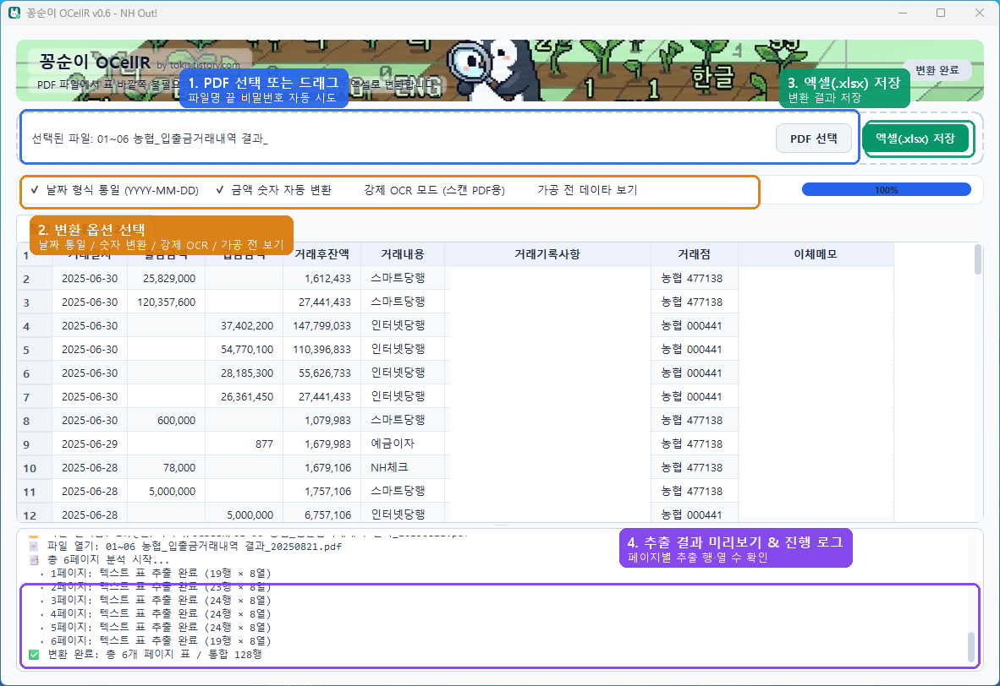

# 꽁순이 OCellR 

  통장이나 카드 내역 등 표가 가득한 PDF 파일을 OCR을 이용해 엑셀(XLS) 파일로 추출해              줍니다.                                                                                        무료로 사용할 수 있는 OCR 서비스들은 웹 브라우저 기반이 많아 결국 과금 없이는 사용량 제약이    큽니다.                                                                                        이 프로그램은 무료 OCR 엔진을 사용해 PC에서 사용량 제약 없이 변환할 수                   있습니다.                                                                                                                                                                                   파일로 저장된 일반 PDF는 그럭저럭 잘 작동하지만, 스캔한 PDF의 경우 추출이 거의 어렵다는        제약이 있습니다.                                                                                '공짜 OCR'이라는 뜻에서 프로그램 이름은 **꽁순이**로 지었습니다.    

  문의 사항이나 버그가 있다면 https://tokis.tistory.com/681 게시물의 댓글로 문의해 주시기 바랍니다.

  

## 1. 기본 사용 순서
1. **PDF 불러오기**
   - 점선 영역으로 PDF 파일을 **드래그 앤 드롭**하거나, 오른쪽 **[PDF 선택]** 버튼을 눌러 파일을 선택합니다.
   - 파일명 끝에 비밀번호가 포함된 경우(예: `... 711020.pdf`) 자동으로 해당 단어를 비밀 번호로 먼저 사용하며, 필요한 경우에만 비밀번호 입력창이 나타납니다.
2. **변환 결과 확인**
   - 상단 오른쪽 상태 배지가 **변환 완료**로 바뀌고, 가운데 표(`통합 거래내역`)에 추출된 데이터가 표시됩니다.
   - 하단 로그 창에서 페이지별 추출 행·열 수와 전체 통합 행 수를 확인할 수 있습니다.
3. **엑셀 저장**
   - **[엑셀(.xlsx) 저장]** 버튼을 눌러 변환된 거래내역을 엑셀 파일로 저장합니다.
   - 

## 2. 옵션 설명
- **날짜 형식 통일 (YYYY-MM-DD)**: 다양한 날짜 표기(`YYYY.MM.DD`, `YY/MM/DD`, `YYMMDD` 등)를 `YYYY-MM-DD` 형식으로 통일합니다.
- **금액 숫자 자동 변환**: 쉼표가 포함된 금액 문자열을 엑셀에서 바로 계산 가능한 숫자 형식으로 저장합니다.
- **강제 OCR 모드 (스캔 PDF용)**: 텍스트 복사가 되지 않는 스캔 PDF나 이미지 PDF를 변환할 때 체크합니다.
- **가공 전 데이타 보기**:
  - 체크 시 필터링으로 제외된 행(반복 헤더, 합계/고객센터 등)을 화면에서 연한 회색으로 함께 표시합니다.
  - 이 상태에서 엑셀로 저장하면 파일명이 `*_변환결과_가공전.xlsx`로 저장되며, 제외된 행이 연한 빨간색(`#FFCCCC`)으로 강조됩니다.
 

꽁순이 OCellR v0.6 - NH Out! 기술 사양서

1. 기본 정보
- 프로그램명: 꽁순이 OCellR v0.6 - NH Out!
- 실행 파일: ocellr_nh_out.py (단일 파일 실행형)
- 배너 이미지: BG.webp (실행 파일과 동일 폴더 내 배치 시 자동 적용)

2. 런타임 및 GUI
- 런타임: Python 3.12 우선 실행 (py -3.12 자동 재실행, onnxruntime 호환)
- GUI 프레임워크: PyQt6 (드래그 앤 드롭, 테이블 미리보기, 비동기 변환 워커)

3. 핵심 엔진 및 라이브러리
- PDF 표 추출 엔진: pdfplumber (텍스트·좌표 기반 표 추출 및 페이지 간 열 경계 상속)
- PDF 렌더링 엔진: pypdfium2 (스캔·이미지 PDF 페이지 렌더링)
- OCR 엔진: RapidOCR (PPOCRV5 + mobile 인식 모델, onnxruntime 기반)
- 엑셀 생성 엔진: openpyxl (날짜 YYYY-MM-DD 통일, 금액 숫자 변환, 가공 전 데이터 #FFCCCC 강조 저장)
